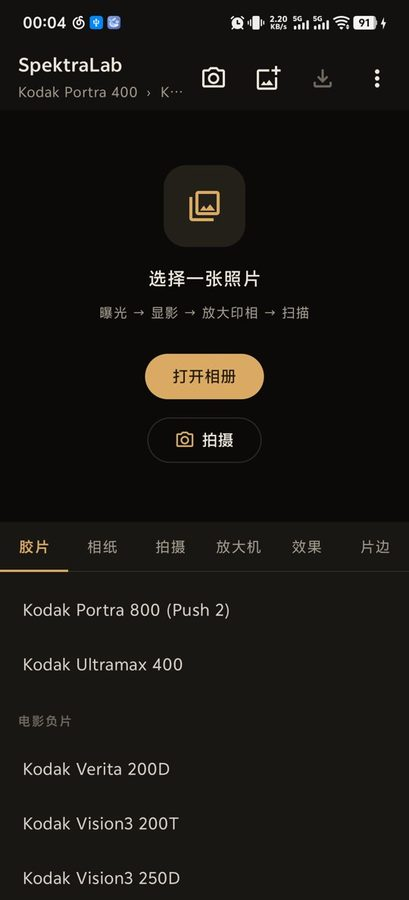
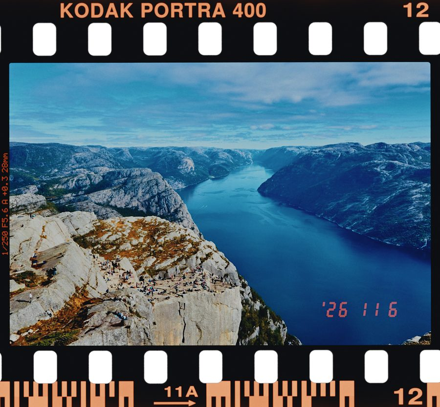
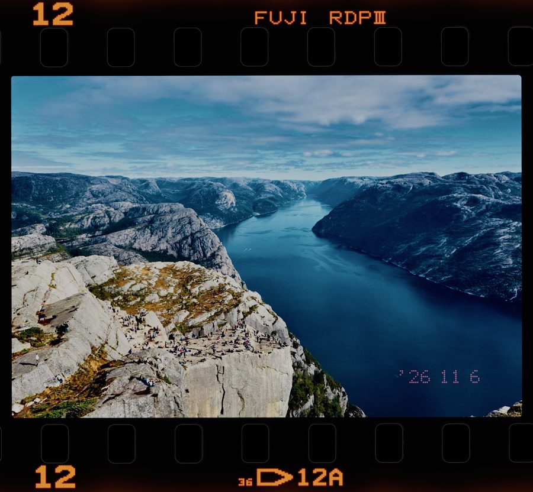
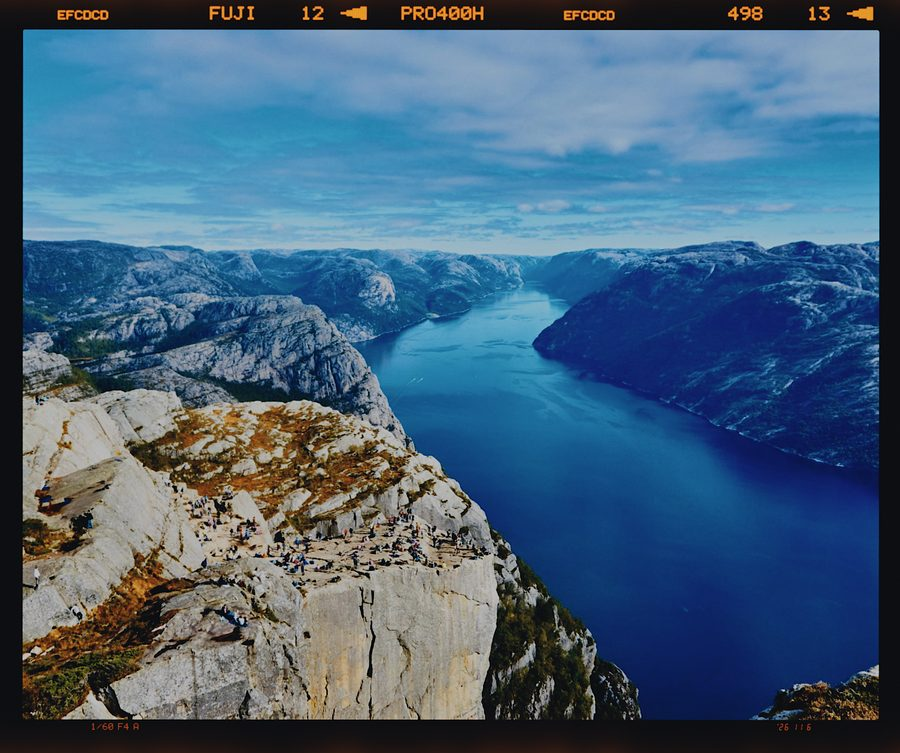
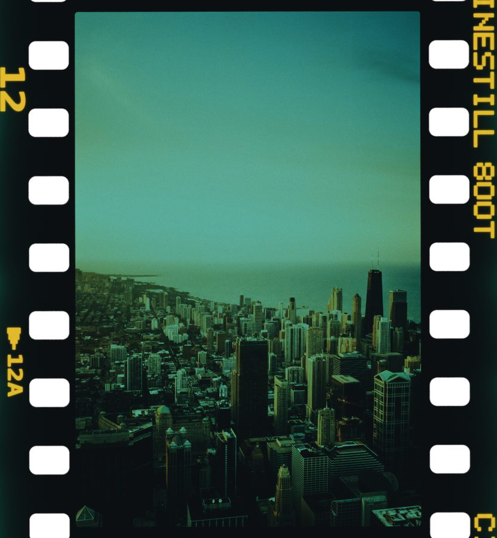
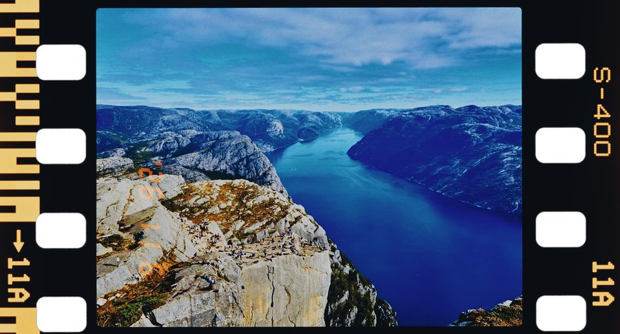
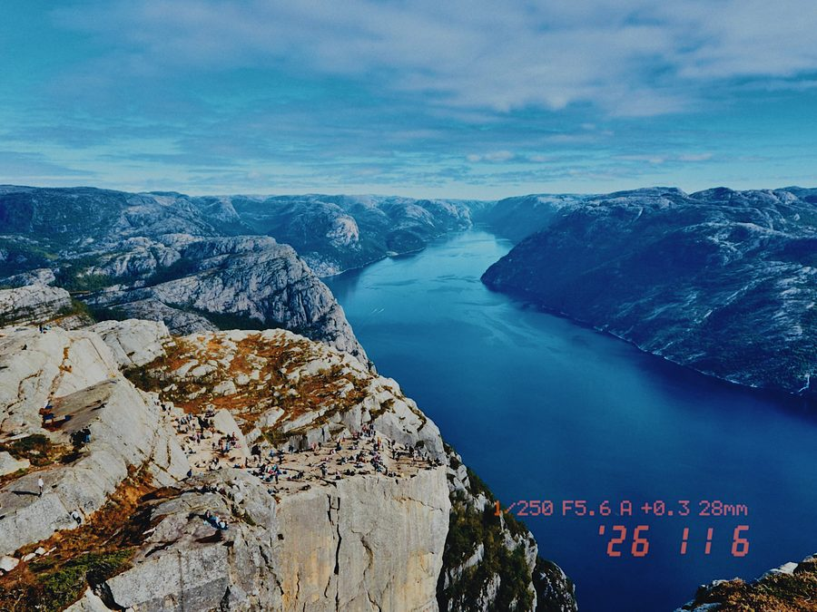
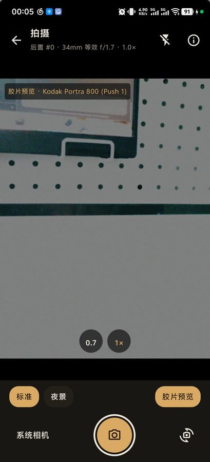

# SpektraDroid UI 设计文档

范围：工作台、手机相机、USB 监视器，以及共享胶片面板和素材回看。实现见 `app/src/main/java/com/spektralab/android/ui/`。交接与技术细节见 [HANDOFF.md](HANDOFF.md)。

---

## 1. 设计语言（沿用现有规范，新页面没有新增 token）

### 1.1 颜色（`Theme.kt` → `Palette`）

| Token | 值 | 用途 |
|---|---|---|
| `Canvas` | `#0B0A09` | 照片背后 |
| `Background` | `#13110F` | 页面底色 |
| `Panel` | `#1A1714` | 控制面板、拍摄页底栏 |
| `PanelRaised` | `#242019` | 未选中的胶囊、弹窗底色 |
| `Hairline` | `#2E2923` | 分隔线、禁用的快门 |
| `Text` / `TextDim` / `TextFaint` | `#EDE6DA` / `#A49A8B` / `#6F675C` | 正文 / 次要 / 说明与禁用 |
| `Amber` | `#E3A857` | 唯一强调色：选中态、主按钮、快门 |
| `AmberDim` | `#6B4F2C` | 选中行底色（35–45% 透明度）、提示框 |
| `AmberInk` | `#241806` | 琥珀底上的文字/图标 |
| `Error` | `#E5826A` | 错误 |

拍摄页的取景区是纯黑 `#000`，比编辑器更暗：取景时不让界面颜色干扰对画面的判断。

### 1.2 字号

| 用途 | 字号 |
|---|---|
| 顶栏标题 | 16 sp SemiBold |
| 标签页 | 13 sp（原 14 sp，6 个标签放不下后改小） |
| 列表行 / 开关标题 | 14 sp |
| 胶囊 Pills / 拍摄模式 Chip | 13 sp Medium |
| 节标题 `SectionHeader`、滑块说明、开关说明 | 11 sp |
| 角标 Tag（「原图」「胶片预览 · …」） | 11 sp，`#99000000` 底，4 dp 圆角 |

### 1.3 组件（`Components.kt`，新页面全部复用）

| 组件 | 规格 | 在片边面板里的用法 |
|---|---|---|
| `SectionHeader` | 11 sp 大写感的小标题，可带右侧注释 | 「胶片边框」「日期打印」 |
| `SwitchRow` | 标题 + 说明 + 开关，可禁用 | 总开关、「同时打印拍摄数据」 |
| `Pills` | FlowRow 胶囊，选中 Amber 底，16 dp 圆角，间距 8 dp | 格式、扫描范围、片门、齿孔、样式、顺序、位置、角落 |
| `ParamSlider` | 标签 + 数值 + 说明 + 滑条；偏离默认值时右侧出现 ↺ 重置按钮；拖动中只渲染草稿档 | 帧号、雾化、漏光、字号、亮度 |
| `Notice` | AmberDim 35% 底的提示块 | 「拍摄」页：边框开启时画幅由片边决定 |

---

## 2. 信息架构

底部固定三个模式，切换保留当前照片。工作台恢复自身调整；相机和监视器共享拍摄设置。需要把某套效果带到另一种模式时，保存为命名配方再调用：

- **工作台**：导入图片、对比原片、完整胶片处理、导出。底部素材栏汇总导入、拍摄、接收和成片。
- **相机**：手机取景与拍摄，拍摄参数 / 胶片参数可展开，拍后留在相机，素材栏即时增加缩略图。
- **监视器**：USB 索尼连接、低分辨率实时胶片监看、监看视频录制、照片传输与本页素材回看。

相机取景器始终限制在可用区域内；横屏左侧取景、右侧滚动控制。快门、系统相机和前后切换固定在滚动区外，参数入口置于调整面板上方。竖屏展开控制时保留取景区域，控制过长可滚动。相机曝光是设备曝光补偿，胶片面板的曝光是冲印参数，两者分别标注。

测光提供自动、中央区域、点按区域。使用 CameraX 的 AE/AF 区域请求，并按设备能力禁用不可用项。区域选择不是厂商相机的矩阵 / 点测光算法枚举。触点经 PreviewView 的坐标映射处理，避免旋转与裁切后测光位置错位。

素材栏点按可应用内看图或播放 MP4；原片可进入工作台并恢复其胶片设置，成片可重新打开关联原片继续编辑。素材可以从列表移除，原文件保留。缩略条只列最近30项，「查看全部」进入持久素材库，可按文件名、来源、照片 / RAW-TIFF / 视频筛选；详情可前后切换、双指缩放至5倍及复位。失效文件显示原因与重试，不无限转圈。视频退后台暂停，关闭详情释放播放器。缩略图展示原片，完整胶片成片需要在工作台导出；监看视频按录制的滤镜直接播放。

监视器录制 / 停止和断开按钮位于顶栏下方，不受参数区滚动影响。离开监视器时先结束传输、封装并保存录制，再切换模式。录制期间素材入口禁用，避免遮住实时取景误操作。未接实体相机时，调试版保留模拟器演示入口。

---

## 2.1 胶片配方

工作台「更多 → 胶片配方 · 保存 / 调用」，相机 / 监视器「胶片参数 → 胶片配方 · 保存 / 调用」。保存完整胶片、相纸、效果、片边与日期设置；配方名1–40字，同名不覆盖，支持调用、改名、确认移除。设备曝光、镜头和测光不属于配方。配方存于本机，尚无导入 / 导出。小屏与横屏弹窗可滚动。

## 3. 编辑器的改动



### 3.1 入口
- 顶栏在「选择照片」**左边**加相机图标（`PhotoCamera`，Text 色）；
- 空状态在「打开相册」主按钮下面加一个描边按钮「📷 拍摄」：主次分明，相册仍是主路径。

### 3.2 照片区（`PhotoViewer`）
- 开胶片边框后，结果图是**胶片画布**（比原图大，宽高比不同）。照片区按**结果图**的宽高比布局；
- 长按看原图、分屏对比时，原图在同一个矩形内**等比居中**（contain），不会被拉伸；
- 缩放和平移的边界按结果图计算。

### 3.3 「拍摄」标签（相机参数）
胶片边框开着时，在「画幅」上方显示提示：「胶片边框已开启：画幅由「片边」里的胶片格式决定（135）」。打开边框时，片边格式会按当前「画幅」预设初始化（半格→半格，645→645……4×5→6×9）。

---

## 4. 「片边」面板

### 4.1 结构与显隐规则

```
胶片边框 ─────────────────────────────
[开关] 胶片边框
       说明：把画面放回整条胶片……画面会按片门比例居中裁切。
  ↓ 开启后显示
  胶片格式   (135)(半格)(XPan)(645)(6×6)(6×7)(6×8)(6×9)(6×12)(6×17)
  扫描范围   (整条)(窄边)
  片门形状   (自动)(方角)(圆角)(耳形)(肩形)(折角)
  齿孔       (透光)(黑底)                    ← 仅 135 系（有齿孔）显示
  帧号       0–99，0 显示「随机」
  边缘雾化   ×0.0–×4.0，默认 ×1.0
  漏光       ×0.0–×4.0，默认 ×0.0
                         [换一台相机（机身 #232）]   ← 右对齐文字按钮

日期打印 ─────────────────────────────
[开关] 日期打印
       说明（动态）：见 4.2
  ↓ 开启且当前相机有日期后背时显示
  样式       (液晶)(点阵)(仅数据)
  顺序       (年 月 日)(月 日 年)             ← 样式≠仅数据
  [开关] 同时打印拍摄数据                       ← 样式≠仅数据
         说明：「1/250 F5.6 A +0.3 28mm」 · 印在两帧之间 / 片边空白处 / 画面内日期旁
  位置       (画面内)(帧间)                   ← 135 系且样式≠仅数据
             「帧间」需要开启胶片边框……        ← 选了帧间但边框没开时的提示
  角落       (右下)(左下)(右上)(左上)          ← 印在画面内时
  字号       ×0.40–×3.00，默认 ×1.00
  亮度       −2.0–+8.0 EV，默认 +3.5 EV

尾注：边框与日期都按 SpektraLab 的方式作为底片上的曝光模拟……
```

规则依据是桌面版 `FilmEdge.swift` 里的 `draws()`、`prints()`、`printsInMargin`：**UI 只提供引擎真的会画出来的选项**，不让用户选了没效果。

### 4.2 日期开关的说明文案（按情况）

| 情况 | 说明 |
|---|---|
| 宽幅（XPan / 6×12 / 6×17） | 「XPan 宽幅相机没有日期后背」，开关禁用 |
| 还没打开照片 | 「从照片 EXIF 读取拍摄日期，像胶片相机的日期后背一样曝光在底片上」 |
| 照片有日期 | 「将打印：'26 11 6」（按所选顺序实时预览） |
| 照片没有日期 | 「这张照片没有拍摄日期（EXIF）」 |

### 4.3 设计决策
- **为什么是独立标签页，不放进「效果」**：边框和日期决定的是输出的形状和内容，不是影调。放进「效果」会让那个页面过长，也模糊了「调影调」和「出成品」的区别。
- **胶片型号不做成可编辑文字**：片边字样跟着所选胶片自动生成（Kodak 印「KODAK PORTRA 400」，Provia 印「FUJI RDPIII」，CineStill 印自己的名字），和真胶片一样；
- **机身是每个用户一台**：「换一台相机」会重新抽取片门形状、片门间隙、齿孔相位；同一台机身拍的每一帧边框都一致。帧种子按照片自动生成，所以每张照片的过片误差、扫描偏移各不相同，但同一张照片每次渲染结果一致；
- 改这些参数都要**重新显影底片**（它们是底片上的曝光），所以滑块拖动时只渲染草稿档，松手后再渲染完整预览，和曝光滑块的交互一致。

### 4.4 输出样张（主机端渲染，与手机同一引擎）

| | |
|---|---|
|  Kodak Portra 400 · 135 · 液晶日期 + 数据（帧间） |  Provia 100F · 黑底齿孔 · 点阵日期 |
|  Pro 400H · 6×7 · 日期和数据印在片边空白处 |  CineStill 800T · 竖拍（胶片纵向走） |
|  X-Tra 400 · 半格 |  不开边框，仅日期 + 数据（数据行在日期上方） |

---

## 5. 拍摄页



### 5.1 布局（竖屏）

| 区域 | 内容 | 规格 |
|---|---|---|
| 顶栏 56 dp | ← 返回；「拍摄」+ 一行镜头参数（`后置 #0 · 34mm 等效 f/1.7 · 1.0×`）；闪光灯（有闪光灯才显示）；ⓘ 摄像头参数 | 黑底 |
| 取景器 | 宽度铺满、**3:4**（拍摄输出也用 4:3），垂直居中；`FILL_CENTER` | 双指缩放 = 变焦 |
| 镜头档 | 取景器底部居中的圆形按钮，直径 40 dp，`#99000000` 底；选中项 Amber 字并带「×」 | 由物理镜头的等效焦距换算出变焦比（如 0.7 / 1），单摄且最大变焦 ≥2 时补一个 2 |
| 角标 | 左上「胶片预览 · Kodak Portra 400」 | 只在胶片预览开着时 |
| 底栏 | 第一行：模式 Chip（标准 / HDR / 夜景 / 自动，**只显示这台设备支持的**），右侧「胶片预览」；说明行（见 5.3）；第二行：「系统相机」文字按钮 · 72 dp 快门（3 dp Text 色描边 + Amber 实心，拍摄中变 Hairline）· 前后切换 | Panel 底 |

### 5.2 状态

| 状态 | 表现 |
|---|---|
| 没有相机权限 | 取景区显示「需要相机权限」+ Amber「授权」按钮；拒绝后显示「没有相机权限」 |
| 正在拍摄 | 快门禁用变灰，取景器中央转圈 |
| 绑定失败 / 拍摄失败 | AlertDialog 显示原因；扩展模式打不开时自动退回「标准」并提示 |
| 只有一种朝向的摄像头 | 前后切换按钮禁用 |

### 5.3 HDR 的呈现
HDR 优先用手机自己的处理，UI 上如实告诉用户用的是哪一种：

| 设备情况 | 模式条 | 说明行 |
|---|---|---|
| 有 CameraX HDR 扩展 | 显示 HDR | 选中时：「HDR：厂商 HDR 扩展（手机自己的多帧合成，取景画面不一定显示效果）」 |
| 没有扩展、HAL 支持 HDR 场景模式（这台 vivo） | 显示 HDR | 选中时：「HDR：HAL HDR 场景模式（……）」 |
| 都不支持 | 不显示 HDR | 「这台设备没有向第三方开放 HDR；可用「系统相机」拍摄，用手机自带的处理。」 |

「系统相机」始终可用：调起手机自带相机拍照，回传后留在相机素材栏。这是能拿到厂商全部算法（HDR、夜景、多摄融合）的兜底方式。

### 5.4 实时胶片预览
- 用编辑器当前的胶片和相纸，在 480 px 小图上实时渲染，盖在取景器上方；**不带边框和日期**（取景器应显示画面本身）；
- 扩展会话（夜景，或走扩展的 HDR）不支持这条分析流，这些模式下「胶片预览」变灰；
- 前置摄像头的胶片预览做镜像，和取景器（PreviewView）一致。拍出的照片是否镜像沿用 CameraX 的默认行为，**未在真机上确认**。

### 5.5 摄像头参数弹窗
列出系统向应用开放的每一个摄像头：朝向和 id、是否多摄融合、焦距（等效焦距）、光圈、传感器尺寸、像素、变焦范围、硬件级别、RAW / 手动曝光 / HDR 场景 / 闪光灯，以及逻辑摄像头背后的物理镜头。点一行切换到这个摄像头，当前摄像头用 AmberDim 底色标出。

---

## 6. 已知的设计问题 / 待改进（2026-11-08 更新）

1. 片边和日期选项较长，后续可将机身形状等高级选项折叠。
2. 片边仍按片门比例居中裁切，尚无可交互裁切框、旋转工具。
3. 这台 vivo 的第三颗镜头是否向第三方开放，仍需实体设备确认。
4. 暂无批量选择 / 批量冲印、撤销历史、配方导出、素材收藏评级。
5. Android 15 + 当前 Compose 的全屏弹窗曾按整屏测量却被系统裁短，造成底部操作在屏外；素材库 / 详情现展开 Activity 上下文，按主窗口系统边距限制内容高度。修改对话框后必须截图检查最底部操作。
6. 文内早期示意截图仅用于颜色和片边说明；当前三模式、配方及素材库截图见 [WORKSTATION_VALIDATION.md](WORKSTATION_VALIDATION.md)。
