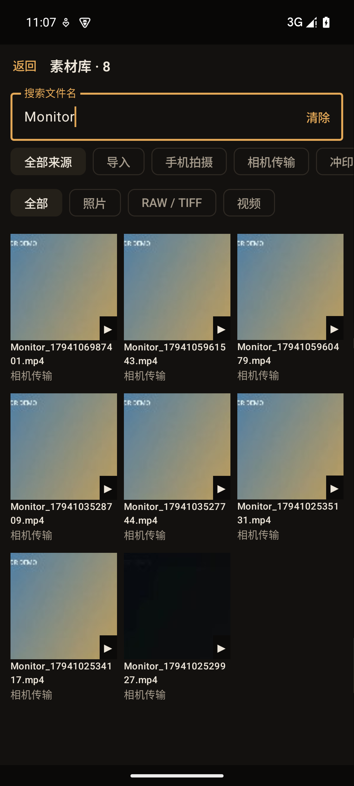
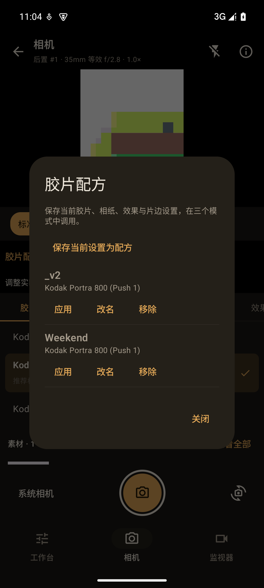
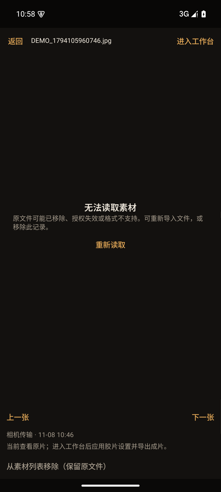
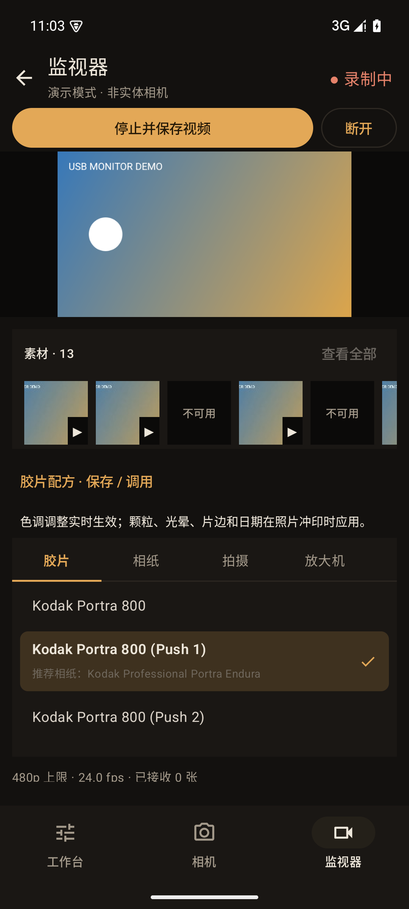
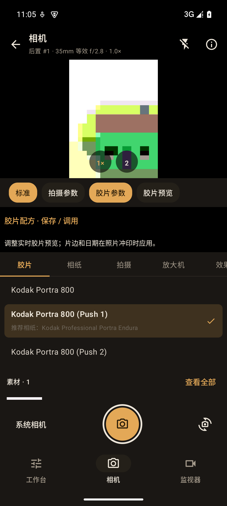
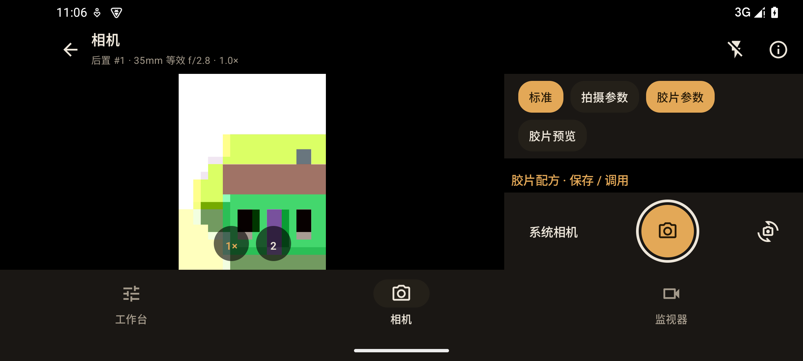

# 三模式工作站验证

2026-11-08（北京时间），本地未发布开发版；Android 15 / API 35 arm64 模拟器。

## 上一轮基线：功能与操作

- 底部工作台 / 相机 / 监视器；拍完留在相机，出现素材缩略图。
- 相机曝光补偿设置并等待 CameraX 确认；模拟器实际设置 +1 EV。
- 自动 / 中央 / 点按区域测光，取景触点映射到 CameraX，显示选区。
- 相机和监视器均可展开共享完整胶片面板；监视器无须重连即可更新色调。
- 照片 / RAW / 视频素材目录持久化；原片、冲印设置、成片关联。
- 已在模拟器实际拍照、查看原片、进入工作台；已打开监看视频回放。
- 已检查竖屏、横屏相机和工作台、监视器参数展开。窄高不足时控制区域滚动，取景不覆盖顶栏。
- 胶片预览开关无需重开相机会话，因此保留曝光和区域测光选择。
- 手机及 USB 原片保持原始文件；缩略图显示原片，工作台输出完整胶片成片。监看视频包含录制时的色调。

## 回归范围

`WorkstationTest`：目录重载 / URI 去重 / 参数与原片关联；监视器连接中动态调色、照片入库与录制结束入库；RAW 缩略解码不删除编辑器持有的源缓存（含同一文件两个编辑器所有权交接）。

`TetherTest`：9 项已有 USB / 录制 / 全尺寸导出回归。

`NativeImportTest`、`AndroidEngineTest`：TIFF、DNG 精度、损坏输入、胶片片边与日期、相机公开能力，以及本地真实 RAW fixtures。

追加回归暴露并修复既有初始化竞争：渲染协程可能在 `requests` Channel 和记忆字段初始化之前运行。初始化代码现移至相关字段之后。修复前完整测试进程崩溃，修复后重新验证。

最终构建与测试日志保存在仓库外 `.android-dev/workstation-*.log`：

| 验证 | 结果 |
|---|---|
| Debug 构建 / Lint | 成功；0 错误、17 既有警告 |
| Release / R8 / 签名 / Lint | 成功；0 错误、17 既有警告 |
| 最终 Debug 相关回归 | 22 项全过，98.056 秒，0 跳过；包含模拟器现有8份真实RAW的解码与胶片输出 |
| 最终 Release 相关回归 | 22 项中21项通过、1项缺外部RAW目录而跳过，11.765 秒 |
| Release 工作站 / USB 专项复核 | 12 项全过，6.342 秒，无跳过 |

本轮没有重新跑9份61MP等全尺寸真实RAW，旧结果见 USB_FULL_RAW_VALIDATION；也不能把本轮8份外部RAW说成历史15份全部再次验证。

APK 存仓库外 `.android-dev/builds/SpektraLab-Workstation-dev.apk` 与 `SpektraLab-Workstation-release.apk`；最终调试版已安装模拟器，未安装到断开的实体手机。本轮无 Git 提交、推送和发布，版本号仍为1.2/3开发中，正式APK只是本地验证产物。

上一轮 SHA-256（以下路径已被本轮APK覆盖，当前校验值见追加验证）：Debug `550fbf99d964678da25a73a25c5bcf02092ceeb1703a10a451cd81d03cb2e9a2`；Release `7d4fad6456304ad964ff20630d85b25c866655ea835265bbf85057cbae3773e4`。

## 边界

本轮无实体手机 / Sony 接入；不能将模拟器区域请求成功当作手机测光准确度，也不能将演示监看当作各 Sony 机型兼容性确认。

中央 / 点按使用公开 AE 区域 API，并非厂商的矩阵测光算法。手动 ISO / 快门 / 光圈尚未添加。系统完整相机仍供使用厂商专业 / RAW / 长曝光等模式，返回后明确选择照片，留在本页素材栏。

监看 LUT 仅颜色；颗粒、光晕、片边和日期在工作台照片冲印。录制的参数快照记录开拍时设置，视频后续逐帧色调已经烘焙，不提供可逆的视频调参时间线。

列表移除保留原文件；来源文件被外部删除或撤回授权后需要重新导入。旧版本未记录的历史素材需手动导入。本轮已补素材搜索与配方命名；批量选择与编辑撤销历史仍未实现。


## 追加验证：配方与素材库优化

2026-11-07（洛杉矶） / 2026-11-08（北京）。最终开发包的模拟器验证，取代上文旧APK校验值；引擎和解码代码本轮未修改。

### 已实现与实际操作

- 工作台菜单、相机胶片参数和监视器胶片参数均提供命名配方入口；模拟器实际保存、改名、调用、移除确认；重名拒绝由自动回归测试覆盖。
- 素材缩略条最近30项，「查看全部」网格；实际输入Monitor搜索、清空搜索、按视频筛选、打开失效照片、重试、前后切换、移除失效记录。来源 / 类型与搜索的组合另由回归测试覆盖。
- 图片详情实现双指缩放、平移与复位；视频关闭释放播放器，退后台暂停。未做长时间播放、可变帧率和多厂商视频兼容验证。
- 相机竖屏 / 横屏参数展开检查；固定快门，参数入口先于展开面板。模拟器 CameraX 初始化偶有约10秒延迟（虚拟设备报告前摄缺失，实际只开放后摄#1）；等待后正常显示取景，未因此修改实体设备相机选择规则。
- 监视器模拟演示实际展开胶片参数、开始录制、停止并保存；顶部录制按钮不随控制区域滚动。
- Android15素材详情底部操作超出窗口的问题已复现并修复，最终截图和实际点按确认列表移除可见。

### 最终检查

| 验证 | 结果 |
|---|---|
| Debug 构建 / AndroidTest包 / Lint | 成功；0错误、17既有警告 |
| Release签名 / R8 / AndroidTest包 / Lint | 成功；0错误、17既有警告 |
| 最终 Debug WorkstationTest + TetherTest | 15项通过，7.195秒，0跳过 |
| 最终 Release WorkstationTest + TetherTest | 15项通过，7.073秒，0跳过 |
| Git空白检查 | `git diff --check`通过 |

WorkstationTest共6项：配方持久化与重名防护；组合筛选；模式调色隔离与原片记录保护；目录重载和恢复URI对子成片的更新；连接中动态调色及媒体入库；编辑器RAW缓存所有权。TetherTest共9项，包含USB协议fixture、视频、完整尺寸合成DNG及编辑器导出。两种构建顺序执行，未并行占用模拟器相机 / 编码器。

本轮没有重跑历史15份公开RAW或9份全尺寸RAW，不能把本轮结果说成新增真实RAW兼容验证。没有实体手机或Sony接入。最终调试包已安装模拟器。

日志在仓库外 `.android-dev/workstation-optimize-{build,release-build,debug-tests,release-tests}.log`。本轮没有提交、推送或GitHub发布；版本仍是1.2/3开发中。

当前APK：

- `.android-dev/builds/SpektraLab-Workstation-dev.apk`：SHA-256 `036bbd912f53912b1b94d125d168414e4f54878995d8958d4ae264861b152c9a`
- `.android-dev/builds/SpektraLab-Workstation-release.apk`：SHA-256 `0c8673c5045eea4541a460ccb74fc1904cf539d02c04ae4e49d6899e91bbe0c8`

复现（已配置SDK/JDK/LibRaw；正式构建另设仓库外签名配置）：

```sh
./gradlew assembleDebug assembleDebugAndroidTest lintDebug
adb install -r -t app/build/outputs/apk/debug/app-debug.apk
adb install -r -t app/build/outputs/apk/androidTest/debug/app-debug-androidTest.apk
adb shell am instrument -w -r -e class com.spektralab.android.WorkstationTest,com.spektralab.android.TetherTest com.spektralab.android.dev.test/androidx.test.runner.AndroidJUnitRunner
./gradlew assembleRelease assembleReleaseAndroidTest lintRelease -PtestBuildType=release
adb install -r -t app/build/outputs/apk/release/app-release.apk
adb install -r -t app/build/outputs/apk/androidTest/release/app-release-androidTest.apk
adb shell am instrument -w -r -e class com.spektralab.android.WorkstationTest,com.spektralab.android.TetherTest com.spektralab.android.test/androidx.test.runner.AndroidJUnitRunner
```

### 操作截图

截图来自模拟器；列表中的不可用项是历史测试已经删除原文件留下的记录，本轮修复了新测试的清理，不自动清理用户已有记录。

| 素材库（输入搜索） | 配方 |
|---|---|
|  |  |

| 失效素材与完整底部操作 | 胶片面板展开期间录制 |
|---|---|
|  |  |

| 相机竖屏（展开胶片参数） | 相机横屏（右侧控制可滚动） |
|---|---|
|  |  |

## dev 提交前检查

2026-11-09（北京时间）。待推送代码的实际复核；未修改应用实现，未创建新版本发布。

- `assembleDebug assembleDebugAndroidTest lintDebug` 成功；Lint为0错误、17警告、1条信息。
- 模拟器安装沿用原有开发签名，不卸载应用或清除素材。
- `AndroidEngineTest` + `NativeImportTest` + `WorkstationTest` + `TetherTest`：**25项通过，88.430秒，0跳过**。包含模拟器已有8份真实RAW的640／1024解码与胶片输出，不代表历史15份或9份全尺寸RAW再次验证。
- 本轮未重新执行Release构建；此前Release／R8结果见上文。没有实体手机或Sony连接。
- 日志保存在仓库外 `.android-dev/dev-push-build.log` 和 `.android-dev/dev-push-tests.log`；`git diff --check`通过，待提交文件未包含APK、RAW、签名或登录凭据。
- 页面审查发现的问题仍待修复，见 [UI_AUDIT.md](UI_AUDIT.md)，不能把自动测试通过当作页面设计已完善。

### 后续限制

未命名工作台 / 拍摄上下文仅在ViewModel存活期间分别保留；命名配方和素材记录跨重启持久化。配方尚无分享导出、批量冲印、撤销历史。缩略缓存暂未设容量上限，原文件不会自动删除。实体Sony机型、真机测光效果、长时间监看仍按原待测表执行。
